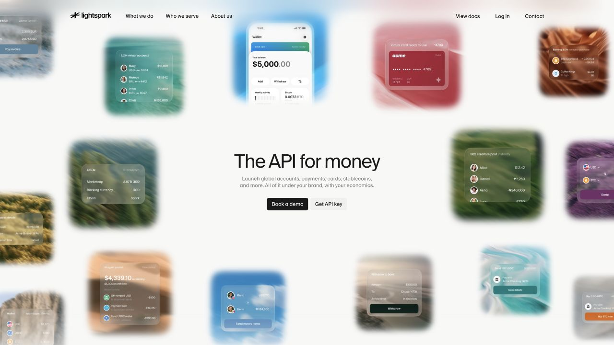

# 网站还原 · Website recreation studies

把喜欢的网页认真还原，再把喜欢的原因拆开。一个持续积累的 React 网页复刻与视觉学习系列：保留第一感受，核对可观察的设计手法，提炼带 label 的可复用组件与原则。



## 学习目录

| # | 网站 | 感受标签 | 复刻与笔记 |
| --- | --- | --- | --- |
| 001 | [Lightspark](https://www.lightspark.com/) | 苹果风 · 现代 · 情绪性色彩 · 商业感 | [React 项目](lightspark-replica/) · [设计拆解](lightspark-replica/docs/lightspark-design-study.md) · [Label 体系](lightspark-replica/docs/label-taxonomy.md) |

“苹果风”是美灿的主观感受标签，记录视觉联想，并不表示网站采用 Apple 的官方设计规范。

## 本地体验

```sh
cd lightspark-replica
npm ci
npm run dev
```

打开终端给出的地址。`/` 是完整首页复刻，`/study` 是可复用元素的学习展示。网站仅在本地运行；仓库公开用于学习整理，没有配置线上发布。

## 每一篇保留什么

- 原始链接和观察日期，方便分辨后续版本变化
- 主观感受原话，保留“为什么喜欢”的线索
- 页面结构、字体、素材、交互和响应式行为
- 设计 label、可复用原则、适用场景和边界
- React 组件、使用例子和验证记录

新案例可以使用 [学习模板](lightspark-replica/docs/study-template.md)。记录事实与解释的区别，避免把个人喜好写成唯一答案。

## 复用这套流程

已整理为 [website-recreation-study 技能](skills/website-recreation-study/SKILL.md)，包含参考采集、实现路线、代码与设计资源沉淀，以及通用静态资源检查器。

以后可以说：“用 `$website-recreation-study` 复刻这个链接，按我们的学习系列整理。” 默认使用 React 并提供本地预览，同时提炼可维护的独立组件、设计 labels 和感受笔记。网站发布与公开上传按当前授权处理。

## 素材与实现说明

本仓库与被研究网站无关联。Lightspark 的品牌、字体、图片、文案及保留的原始前端模块归原权利人所有；公开可访问不等于开放授权。首个案例为视觉学习保留原始资源，并把新写的可复用模式单独放在 `src/patterns/`。素材来源及实现边界见案例的 [NOTICE](lightspark-replica/NOTICE.md)。
